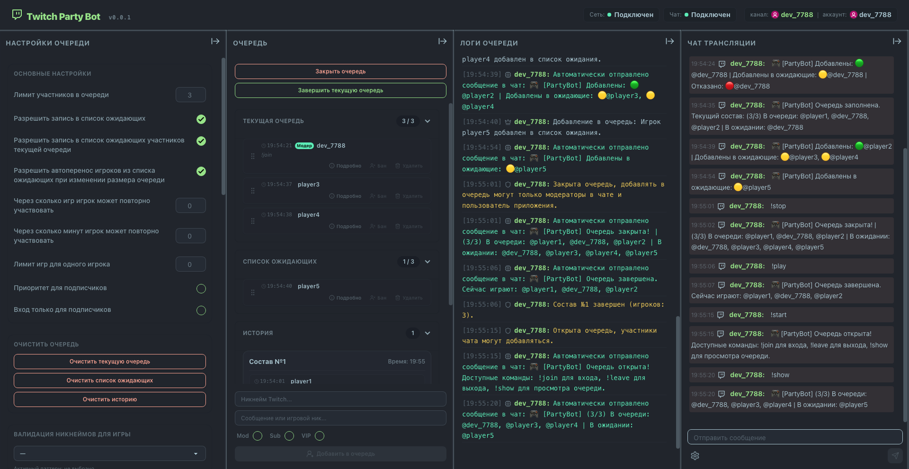

# Twitch Party Bot

[](README.md)


[](https://sergey-maxim0v.github.io/twitch-party-bot/)
[](https://github.com/Sergey-Maxim0v/twitch-party-bot/actions/workflows/deploy.yml)

[](LICENSE)

---



---

**Twitch Party Bot** is a simple and intuitive tool for streamers designed to quickly gather viewers from the chat into a single team. The bot automatically manages the queue and collects players' nicknames for co-op games, saving you from doing it manually.

---

## How it works
1. **Viewers type a command** in the chat, such as `!join` (or any other custom command you set), and the bot automatically adds them to the list.
2. **You get a convenient dashboard** where you can see all the applicants. You can easily add, reorder, or remove players directly via the UI.
3. **Waiting list:** You can open a pre-registration queue so that viewers can secure their spot in advance for the next game.
4. **Automated chat updates:** The bot posts updates directly to your chat when the queue opens, closes, gets full, or changes.
5. **Flexible configuration:** Customize queue limits, chat commands, toggle automated chat messaging, and more.

---

## Quick Start for Streamers

You can run the application in two ways:

* **🚀 Quick Launch (Recommended):** The app is already deployed and ready to go on GitHub Pages: **[sergey-maxim0v.github.io/twitch-party-bot](https://sergey-maxim0v.github.io/twitch-party-bot/)**. Just open the link, log in with your Twitch account (the bot only requires permissions to read and send chat messages), and select the channel where the bot should operate.
* **🛠 Local Setup:** You can run the project locally on your machine. Clone the repository, register your application in the **[Twitch Developer Console](https://dev.twitch.tv/console)** to obtain your credentials. Then, create a `.env` file in the root directory, specify your Client ID (`VITE_TWITCH_CLIENT_ID=your_id`), and run the project following the instructions below.
* **🍴 Forking the project:** If you deploy your own fork to GitHub Pages, set `VITE_TWITCH_CLIENT_ID` in **Settings → Secrets and variables → Actions → Variables** — the build workflow reads it from there.

---

## Architecture & Technical Highlights

* **Authentication (Twitch OAuth):** OAuth authentication via a popup window using the **Implicit Flow** (requested scopes: `chat:read` and `chat:edit`). The access token and session profile are cached and persisted in `localStorage`.
* **Network Layer (Twitch IRC WebSocket):** The app uses a custom lightweight client built on the standard IRC text protocol over WebSockets (`wss://irc-ws.chat.twitch.tv:443`) instead of a third-party chat library.
* **Socket Stability Management:**
    * The `TwitchIrcClient` class encapsulates the Twitch IRC protocol handshake sequence.
    * Handles native `PING / PONG` heartbeats to maintain a stable connection.
    * Supports switching channels on the fly without memory leaks or duplicated asynchronous events. When switching channels, the UI clears the previous screen and logs.
* **Cross-Tab Synchronization:** Real-time application state synchronization across multiple tabs. A custom `useLocalStorage` hook listens to the browser's native `storage` event, automatically updating the state in all open tabs when data changes in any of them.
* **Background Timers (Web Worker):** Heartbeat timers (PING/PONG) run in a dedicated Web Worker so that the browser does not throttle them in an inactive tab and the bot detects a half-open connection in time. The IRC client itself runs on the main thread.

---

## Limitations & Privacy

* **No backend.** The app runs entirely in the browser: the bot reads and sends messages directly through Twitch IRC. No third-party servers are involved, and no analytics or trackers are used.
* **Local data only.** The OAuth token, queue, and settings are stored in the browser's `localStorage`. Clearing site data or logging out resets them.
* **The bot runs only while the tab is open.** Closing the tab or browser stops chat responses. Keep the tab open while streaming.
* **No cross-device sync.** The queue and settings are shared only between tabs of the same browser.
* **Token lifetime.** With Implicit Flow, the Twitch token expires after a limited time and is not refreshed automatically; you will need to log in again.

---

## Dependencies

- **[React 19](https://react.dev) & [TypeScript](https://typescriptlang.org):** Frontend foundation with strict TypeScript typing.
- **[Vite 8](https://vite.dev):** Build tool and development server.
- **[Tailwind CSS v4](https://tailwindcss.com) & [DaisyUI v5](https://daisyui.com):** Styling stack for UI components, themes, and the design system.
- **[@dnd-kit](https://dnd-kit.com):** Primitives for drag-and-drop player reordering.
- **[ESLint](https://eslint.org) & [Simple Git Hooks](https://github.com/toplenboren/simple-git-hooks):** Static code analysis and TypeScript type checking on the pre-commit hook.

## Environment Requirements

* **Node.js 24+** (the version used in CI) and npm.
* A modern browser with WebSocket and Web Worker support.
* For local development, an app registered in the Twitch Developer Console and `VITE_TWITCH_CLIENT_ID` set in `.env`.

## Build and Run Instructions

```bash
# Install all project dependencies
npm install

# Start the local development server
npm run dev

# Run TypeScript type checking (without emitting files)
npm run typecheck

# Codebase linting
npm run lint

# Build the optimized production application
npm run build

# Preview the locally built production app
npm run preview
```

## Project Directory Structure

```plaintext
/
├── .github/                     # GitHub Actions and CI/CD workflow configurations
├── public/                      # Static assets (icons, screenshots)
├── src/                         # Main application source code
│   ├── assets/                  # Shared media assets and static files
│   ├── components/              # Global and layout UI components
│   │   ├── layout/              # Structural grids (Header, Sidebar, Workspace)
│   │   └── QueueCollapse.tsx    # Collapsible lobby queue panel
│   ├── constants/               # Configuration files and constants
│   │   ├── theme.constants.ts   # UI theme configuration presets
│   │   └── twitch.constants.ts  # Twitch API endpoints and scopes specifications
│   ├── features/                # Isolated business logic modules
│   │   ├── app-logs/            # Components for logging network events, app state, and queue changes
│   │   ├── auth/                # OAuth authentication module and streamer context
│   │   ├── queue/               # Queue state management and player lists
│   │   ├── queue-notification/  # Dispatcher for sending trigger notifications to chat
│   │   └── queue-settings/      # QueueSettings configuration interface
│   ├── hooks/                   # Custom reusable React hooks
│   ├── services/                # Low-level infrastructure services
│   │   ├── socket/              # WebSocket integration layer and event bus
│   │   └── twitch/              # TwitchIrcClient class and background Web Worker
│   ├── App.tsx                  # Root application component
│   ├── index.css                # Global styles (Tailwind CSS v4 entry point)
│   └── main.tsx                 # React DOM mount entry point
├── eslint.config.js             # Flat ESLint configuration file
├── tsconfig.app.json            # TypeScript compiler specifications for the client app
├── vite.config.ts               # Vite bundler configuration and plugins setup
└── package.json                 # Project manifest, scripts, and dependency tree
```

---

Happy streaming! 🎥 Have great games! 🎮 Happy coding! 👨‍💻

## License

This project is licensed under the **[MIT](LICENSE)** License.
