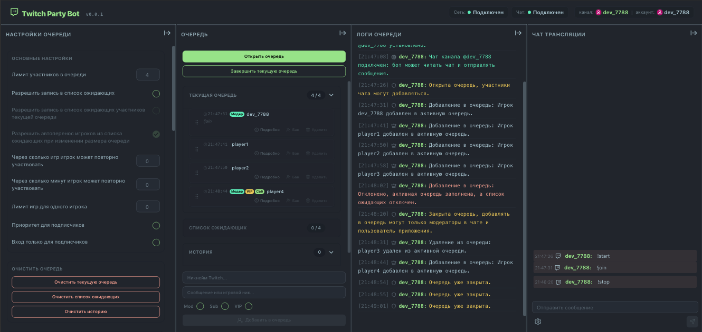
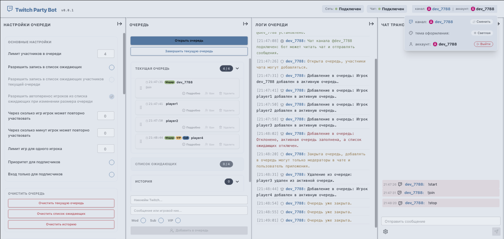

# Twitch Party Bot


[](https://sergey-maxim0v.github.io/twitch-party-bot/)

[](LICENSE)

---

<p align="center">
  
  &nbsp;&nbsp;
  
</p>

---

**Twitch Party Bot** is a simple and intuitive tool for streamers designed to quickly gather viewers from the chat into a single team. The bot automatically manages the queue and collects players' nicknames for co-op games, saving you from doing it manually.

---

### How it works
1. **Viewers type a command** in the chat, such as `!join` (or any other custom command you set), and the bot automatically adds them to the list.
2. **You get a convenient dashboard** where you can see all the applicants. You can easily add, reorder, or remove players directly via the UI.
3. **Waiting list:** You can open a pre-registration queue so that viewers can secure their spot in advance for the next game.
4. **Automated chat updates:** The bot posts updates directly to your chat when the queue opens, closes, gets full, or changes.
5. **Flexible configuration:** Customize queue limits, chat commands, toggle automated chat messaging, and more.

---

### Quick Start for Streamers

You can run the application in two ways:

* **🚀 Quick Launch (Recommended):** The app is already deployed and ready to go on GitHub Pages: **[sergey-maxim0v.github.io/twitch-party-bot](https://sergey-maxim0v.github.io/twitch-party-bot/)**. Just open the link, log in with your Twitch account (the bot only requires permissions to read and send chat messages), and select the channel where the bot should operate.
* **🛠 Local Setup:** You can run the project locally on your machine. Clone the repository, register your application in the **[Twitch Developer Console](https://dev.twitch.tv/console)** to obtain your credentials. Then, create a `.env` file in the root directory, specify your Client ID (`VITE_TWITCH_CLIENT_ID=your_id`), and run the project following the instructions below.

---

### Architecture & Technical Highlights

* **Authentication (Twitch OAuth):** Implements a high-level OAuth authentication flow via a popup window using the **Implicit Flow** scheme (requested scopes: `chat:read` and `chat:edit`). The access token and session profile are cached and persisted in `localStorage`.
* **Network Layer (Twitch IRC WebSocket):** Instead of relying on heavy third-party libraries, the app utilizes a custom lightweight client built on top of the standard IRC text protocol over WebSockets (`wss://irc-ws.chat.twitch.tv:443`).
* **Socket Stability Management:**
    * The `TwitchIrcClient` class encapsulates the Twitch IRC protocol handshake sequence.
    * Properly handles native `PING / PONG` system heartbeats to maintain a stable connection.
    * Supports dynamic "on-the-fly" channel switching without memory leaks or duplicated asynchronous events. When switching channels, the UI guarantees a clean slate by clearing the previous screen and logs.
* **Cross-Tab Synchronization:** Features reactive, real-time application state synchronization across multiple tabs. A custom `useLocalStorage` hook listens to the browser's native `storage` event, automatically updating the state in all open tabs when data changes in any of them.
* **Background Processing (Web Workers):** The network client operates inside a dedicated Web Worker. This ensures that the Twitch IRC WebSocket connection remains stable and is not throttled or terminated by the browser when the application tab is minimized or running in the background.

---

### Dependencies

- **[React 19](https://react.dev) & [TypeScript](https://typescriptlang.org):** A strictly typed frontend foundation.
- **[Vite 8](https://vite.dev):** Next-generation frontend tooling and development server.
- **[Tailwind CSS v4](https://tailwindcss.com) & [DaisyUI v5](https://daisyui.com):** Modern styling stack powering UI components, themes, and design systems.
- **[@dnd-kit](https://dnd-kit.com):** A suite of lightweight primitives for smooth drag-and-drop player reordering.
- **[ESLint](https://eslint.org) & [Simple Git Hooks](https://github.com/toplenboren/simple-git-hooks):** Static code analysis and type safety enforcement on pre-commit stages.

## Build and Run Instructions

```bash
# Install all project dependencies
npm install

# Start the local development server
npm run dev

# Run TypeScript type checking (without emitting files)
npm run typecheck

# Codebase linting
npm run lint

# Build the optimized production application
npm run build

# Preview the locally built production app
npm run preview
```

## Project Directory Structure

```plaintext
/
├── .github/                     # GitHub Actions and CI/CD workflow configurations
├── public/                      # Static assets (icons, screenshots)
├── src/                         # Main application source code
│   ├── assets/                  # Shared media assets and static files
│   ├── components/              # Global and layout UI components
│   │   ├── layout/              # Structural grids (Header, Sidebar, Workspace)
│   │   └── QueueCollapse.tsx    # Collapsible lobby queue panel
│   ├── constants/               # Configuration files and constants
│   │   ├── theme.constants.ts   # UI theme configuration presets
│   │   └── twitch.constants.ts  # Twitch API endpoints and scopes specifications
│   ├── features/                # Isolated domain-driven business logic modules
│   │   ├── app-logs/            # Components for logging network events, app state, and queue changes
│   │   ├── auth/                # OAuth authentication module and streamer context
│   │   ├── queue/               # Queue state management and player lists
│   │   ├── queue-notification/  # Dispatcher for sending trigger notifications to chat
│   │   └── queue-settings/      # QueueSettings configuration interface
│   ├── hooks/                   # Custom reusable React hooks
│   ├── services/                # Low-level infrastructure services
│   │   ├── socket/              # WebSocket integration layer and event bus
│   │   └── twitch/              # TwitchIrcClient class and background Web Workers
│   ├── App.tsx                  # Root application controller component
│   ├── index.css                # Global styles (Tailwind CSS v4 entry point)
│   └── main.tsx                 # React DOM mount entry point
├── eslint.config.js             # Flat ESLint configuration file
├── tsconfig.app.json            # TypeScript compiler specifications for the client app
├── vite.config.ts               # Vite bundler configuration and plugins setup
└── package.json                 # Project manifest, scripts, and dependency tree
```

---

Happy streaming! 🎥 Have great games! 🎮 Happy coding! 👨‍💻

## License

This project is licensed under the **[MIT](LICENSE)** License.
