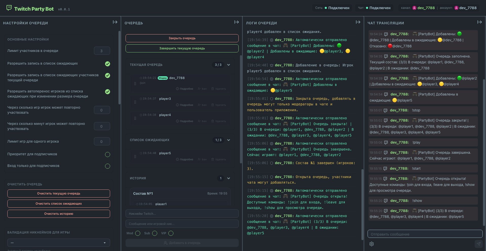

# Twitch Party Bot

[](README.en.md)


[](https://sergey-maxim0v.github.io/twitch-party-bot/)
[](https://github.com/Sergey-Maxim0v/twitch-party-bot/actions/workflows/deploy.yml)

[](LICENSE)

---



---

**Twitch Party Bot** — это простой и понятный инструмент для стримеров, который помогает быстро собрать зрителей из чата в одну команду. Бот сам ведёт очередь и собирает ники игроков для совместных игр, чтобы вам не приходилось делать это вручную.

---

## Как это работает?
1. **Зрители пишут в чат** команду `!join` (или любую другую, которую вы настроите), и бот автоматически добавляет их в список.
2. **У вас есть удобная панель управления**, где видно всех желающих. Игроков можно легко добавлять, менять местами или удалять прямо в интерфейсе.
3. **Список ожидающих:** вы можете открыть предварительную запись, чтобы зрители занимали очередь заранее, на следующую игру.
4. **Автоматические сообщения в чат:** бот сам пишет, когда очередь открывается, закрывается, заполняется или меняется её состав. Отправку нужно включить в настройках — по умолчанию она отключена.
5. **Гибкие настройки:** лимиты очереди, кастомные команды для чата, права модераторов и многое другое.

---

## Возможности

* **Встроенный чат Twitch:** история сообщений, подсветка ролей, цветные ники, системные уведомления и отображение удалённых сообщений.
* **Панель логов:** сетевые события, состояние приложения и изменения в очереди.
* **Управление очередью:** активный состав, список ожидающих, история и сортировка игроков drag-and-drop.
* **Три темы оформления:** Nord, Dim и системная.
* **Гибкие настройки:** лимит участников, кастомные команды, права модераторов, кулдауны и бан-лист.
* **Режимы для подписчиков:** доступ только для подписчиков и приоритет подписчиков.
* **Валидация ников:** проверка ников для популярных игр и платформ — Steam, Battle.net, Riot Games, Epic Games и другие.
* **Синхронизация между вкладками:** изменения очереди и настроек сразу видны во всех открытых вкладках браузера.

---

## Быстрый старт для работы на стриме

Вы можете использовать приложение двумя способами:

* **🚀 Быстрый запуск (Рекомендуется):** Приложение уже развернуто и готово к работе на GitHub Pages: **[sergey-maxim0v.github.io/twitch-party-bot](https://sergey-maxim0v.github.io/twitch-party-bot/)**. Просто перейдите по ссылке, авторизуйтесь под своим Twitch-аккаунтом (для работы бота достаточно разрешения на чтение и отправку сообщений в чат) и выберите канал, на котором будет работать бот.
* **🛠 Локальный запуск:** Вы можете развернуть проект у себя на компьютере. Для этого склонируйте репозиторий и зарегистрируйте собственное приложение в **[Консоли разработчика Twitch](https://dev.twitch.tv/console)**. При регистрации укажите **OAuth Redirect URL** — адрес, по которому будет работать приложение (локально это, например, `http://localhost:5173/`, на GitHub Pages — адрес вашей страницы). Затем создайте в корне проекта файл `.env`, укажите в нём ваш Client ID (`VITE_TWITCH_CLIENT_ID=ваш_id`) и запустите проект по инструкции ниже.
* **🍴 Форк проекта:** Если вы разворачиваете собственный форк на GitHub Pages, задайте `VITE_TWITCH_CLIENT_ID` в **Settings → Secrets and variables → Actions → Variables** — workflow сборки берёт значение оттуда. Также измените `base` в `vite.config.ts` (сейчас там `/twitch-party-bot/`) на `/имя-вашего-репозитория/`, иначе статические ассеты не загрузятся.

---

## Архитектура и принципы работы

* **Собственный IRC-клиент:** лёгкая реализация Twitch IRC вместо сторонних библиотек — хэндшейк, поддержание соединения, переключение каналов на лету и автоматическое переподключение при обрыве сети.
* **Стабильное соединение:** heartbeat-таймеры вынесены в Web Worker, чтобы браузер не душил их в неактивной вкладке, а «полуоткрытое» соединение обнаруживается и пересоздаётся само.
* **Авторизация через Twitch OAuth:** вход выполняется в отдельном окне, с запасным вариантом в текущей вкладке, если браузер блокирует всплывающие окна. Токен и профиль сессии хранятся только внутри вкладки.
* **Модульная структура:** логика разделена на независимые части (авторизация, очередь, уведомления, настройки), инфраструктурные сервисы (сокеты, Twitch IRC) вынесены отдельно.

---

## Ограничения и приватность

* **Нет серверной части.** Приложение полностью работает в браузере: бот читает и отправляет сообщения напрямую через Twitch IRC. Данные не проходят через сторонние серверы, аналитика и трекеры не используются.
* **Данные хранятся локально.** OAuth-токен хранится в сессии текущей вкладки, очередь и настройки — в `localStorage` браузера. Очистка данных сайта сбрасывает всё, а выход из аккаунта удаляет только сессию.
* **Если браузер блокирует Web Storage** (например, в sandbox-iframe), приложение продолжает работать в памяти: данные не сохраняются между перезагрузками, и об этом показывается предупреждение.
* **Бот работает, пока открыта вкладка.** Если закрыть вкладку или браузер, бот перестанет отвечать в чате. Во время стрима вкладку нужно держать открытой.
* **Нет синхронизации между устройствами.** Очередь и настройки общие только для вкладок одного браузера.
* **Срок жизни токена.** Токен Twitch действует ограниченное время и не обновляется автоматически — после истечения потребуется войти заново.

---

## Зависимости (Dependencies)

- **[React 19](https://react.dev) & [TypeScript](https://typescriptlang.org):** Фронтенд-основа проекта на React и TypeScript.
- **[Vite 8](https://vite.dev):** Инструмент сборки и сервер разработки.
- **[Tailwind CSS v4](https://tailwindcss.com) & [DaisyUI v5](https://daisyui.com):** Стек стилизации интерфейса, тем и дизайн-системы компонентов.
- **[@dnd-kit](https://dnd-kit.com):** Набор абстракций для плавной сортировки игроков в очереди с помощью Drag-and-Drop.
- **[ESLint](https://eslint.org) & [Simple Git Hooks](https://github.com/toplenboren/simple-git-hooks):** Статический анализ кода и запуск проверки типов TypeScript на pre-commit хуке.

## Требования к окружению

* **Node.js 24+** (эта версия используется в CI) и npm.
* Современный браузер с поддержкой WebSocket и Web Workers.
* Для локального запуска — приложение, зарегистрированное в Twitch Developer Console, и `VITE_TWITCH_CLIENT_ID` в `.env`.

## Инструкция по сборке и запуску

```bash
# Установка всех зависимостей проекта
npm install

# Запуск локального сервера разработки
npm run dev

# Проверка типов TypeScript (без генерации файлов)
npm run typecheck

# Проверка кодовой базы линтером
npm run lint

# Автоматическое исправление ошибок линтера
npm run lint:fix

# Сборка оптимизированного продакшен-билда
npm run build

# Предварительный локальный просмотр готового билда
npm run preview
```

## Структура папок проекта

```plaintext
/
├── .github/                     # Конфигурация GitHub Actions и CI/CD процессов
├── public/                      # Статические ресурсы (иконки, скриншоты)
├── src/                         # Основной исходный код приложения
│   ├── components/              # Глобальные и компоновочные UI-элементы
│   ├── constants/               # Файлы конфигурации и констант
│   ├── features/                # Изолированные модули бизнес-логики
│   │   ├── app-logs/            # Компоненты логирования системных сетевых событий, работы приложения и изменений в очереди
│   │   ├── auth/                # Модуль авторизации OAuth и контекст стримера
│   │   ├── chanel-info/         # Информация о канале стримера
│   │   ├── queue/               # Стейт-менеджмент очередей и списков игроков
│   │   ├── queue-notification/  # Диспетчер отправки триггерных уведомлений в чат
│   │   └── queue-settings/      # Конфигурация интерфейса QueueSettings
│   ├── hooks/                   # Кастомные React-хуки
│   ├── services/                # Низкоуровневые инфраструктурные сервисы
│   │   ├── socket/              # Архитектура и шина интеграции веб-сокетов
│   │   └── twitch/              # Класс TwitchIrcClient и фоновый Web Worker
│   ├── utils/                   # Общие утилиты форматирования данных
│   ├── App.tsx                  # Корневой управляющий компонент приложения
│   ├── index.css                # Глобальные стили (точка входа Tailwind CSS v4)
│   └── main.tsx                 # Точка монтирования React-приложения в DOM
├── eslint.config.js             # Модульная конфигурация ESLint плоского типа
├── tsconfig.app.json            # Спецификация компилятора TypeScript под клиентскую часть
├── vite.config.ts               # Файл плагинов и конфигурации сборщика Vite
├── package.json                 # Манифест проекта, скрипты и дерево зависимостей
├── README.md                    # Описание проекта на русском языке
├── README.en.md                 # Описание проекта на английском языке
├── TESTING.md                   # Инструкция по тестированию проекта
├── LICENSE                      # Лицензия проекта (MIT)
```

---

Приятных стримов! 🎥 Хороших игр! 🎮 Удачного кодинга! 👨‍💻

---

## Лицензия (License)

Этот проект распространяется под лицензией **[MIT](LICENSE)**.
